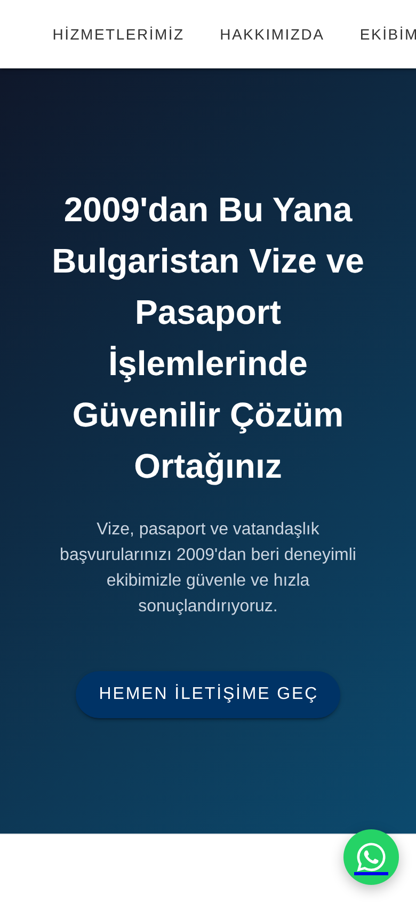

# Deliorman Danışmanlık — Company Website

Multilingual marketing website for **Deliorman Danışmanlık**, a consulting firm in Ankara that has handled Bulgarian visa, passport and citizenship procedures since 2009.

**Live:** https://deliormandanismanlik.netlify.app

| Desktop | Mobile |
|---|---|
|  |  |

## Features
- **Three languages** — Turkish, English and Bulgarian with a runtime language switcher (`vue-i18n`)
- **Contact form** with client-side validation (`vee-validate`) and a required KVKK (Turkish GDPR) consent, submitted through **Netlify Forms** with a honeypot field against spam
- **Privacy notice** dialog (KVKK) and localized validation messages
- **WhatsApp** floating contact button and location sharing
- **Google Maps** embed with one-click directions
- Responsive layout built with **Vuetify 3**; services, process and team sections are data-driven from the translation files
- **SEO basics** — meta / Open Graph / Twitter tags, `sitemap.xml`, `robots.txt`

## Tech stack
Vue 3 (`<script setup>`) · Vite · Vuetify 3 · vue-i18n · vee-validate · Sass · Netlify (hosting + forms)

## Project structure
```
src/
  App.vue                 # page layout: hero, process, services, about, team, contact, location, footer
  components/sections/    # TeamSection, LocationSection
  i18n/{tr,en,bg}/        # translation files (all page content lives here)
  plugins/                # i18n and validation setup
public/                   # logo, sitemap.xml, robots.txt
```

## Run locally
```bash
pnpm install
pnpm dev        # http://localhost:5173
pnpm build      # production build in dist/
```

## Author
Designed and built by **Nazlı Ece Deliormanlı**.
